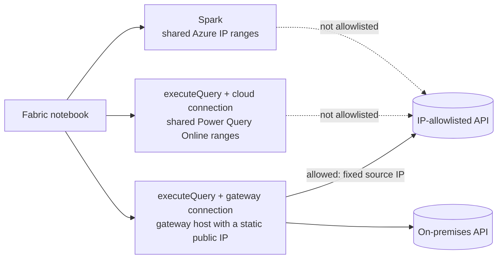

# Power Query in Fabric notebooks with notebookutils

The [November 2026 Fabric update](https://community.fabric.microsoft.com/blog/fbc_fabricupdatesblogs/fabric-november-2026-feature-summary/5414311#community-5414311-mcetoc_1k78v7lte_4) added **Power Query in Fabric notebooks (preview)**. The `notebookutils.powerquery` module runs a Power Query M query from a notebook, through an existing Fabric connection, and returns the result as a PySpark DataFrame.

That gives notebooks something they couldn't do before: reach sources that only Power Query can reach, such as **on-premises systems behind an on-premises data gateway**.

This article covers:

- how the feature works;
- which connections you can use, and how to check them;
- two use cases: calling on-premises APIs, and calling web APIs that only accept traffic from known IP addresses;
- how to monitor the cost;
- the current limitations.

## 1. How it works

There is a single method:

```python
notebookutils.powerquery.executeQuery(query_name, script, connections=None)
```

| Parameter | What it is |
|---|---|
| `query_name` | The query name. A string returns one DataFrame; a list returns a `QueryResults` container. |
| `script` | An M expression, or a full M document that starts with `section`. |
| `connections` | Fabric connection names or IDs, as a string or a list. Leave it out if the query needs no data source. |

A query that builds its own data needs no connection:

```python
script = """
let
    Source = #table(
        type table [Product = text, Quantity = Int64.Type],
        {{"Bike", 2}, {"Helmet", 5}}
    )
in
    Source
"""

df = notebookutils.powerquery.executeQuery("Products", script)
display(df)
```

To read from a real source, write the M as you would in Power Query, and pass the connection that holds the credentials:

```python
script = """
let
    Source = Sql.Database("<server>", "<database>"),
    Products = Source{[Schema = "<schema>", Item = "<table>"]}[Data]
in
    Products
"""

df = notebookutils.powerquery.executeQuery(
    "Products",
    script,
    connections=["<fabric-connection-id>"]
)
display(df)
```

Some points to keep in mind:

- The M script still names the source (server, database, URL), and those details must match the connection you pass.
- Use the connection ID if two connections share a name.
- If you pass a list of connections, every query in the document can use any of them. They aren't matched to queries by position.
- Gateway connections are passed exactly the same way. The query then runs on your gateway, not in the cloud.

To return several queries in one call, send a full `section` document and a list of names:

```python
script = """
section Section1;
shared Products = #table(
    type table [Product = text, Quantity = Int64.Type],
    {{"Bike", 2}, {"Helmet", 5}}
);
shared SelectedProducts = Table.SelectRows(Products, each [Quantity] > 2);
"""

results = notebookutils.powerquery.executeQuery(["Products", "SelectedProducts"], script)
display(results["Products"])
display(results["SelectedProducts"])
```

`QueryResults` also offers `successes`, `failures`, `get()`, `is_all_success()` and `raise_if_failed()`. Run `notebookutils.powerquery.help("executeQuery")` for the details.

## 2. Which connections can a notebook use?

A connection works with `executeQuery` only when all of these are true:

1. **It allows code-first access.** When you create the connection, select **Allow Code-First Artifacts like Notebooks to access this connection (Preview)**. You can't change this setting later. Connections created from the notebook's **Connections** pane have it selected by default.
2. **Its connection type and credential type are allowed in notebooks.** OAuth2 isn't supported.
3. **Your tenant allows it.** A tenant setting controls Fabric connections in notebooks. It is on by default.

To see which connection types and credential types are allowed, use the [List Supported Connection Types](https://learn.microsoft.com/en-us/rest/api/fabric/core/connections/list-supported-connection-types) API. Each connection type in the response has a field called `supportedCredentialTypesForUsageInUserControlledCode`. It lists the credential types allowed in items that run your own code, such as notebooks. If the field is empty, that connection type can't be used from a notebook.

With the Azure CLI:

```bash
az rest --method get \
  --url "https://api.fabric.microsoft.com/v1/connections/supportedConnectionTypes" \
  --resource "https://api.fabric.microsoft.com" \
  --query "value[?supportedCredentialTypesForUsageInUserControlledCode].{connectionType: type, credentials: join(', ', supportedCredentialTypesForUsageInUserControlledCode)}" \
  -o table
```

The call needs the `Connection.Read.All` or `Connection.ReadWrite.All` scope. To list what a specific gateway supports, add `?gatewayId=<gateway-id>` to the URL.

On 2026-11-27, the call returned 11 cloud connection types:

| Connection type | Credential types allowed in notebooks |
|---|---|
| SQL | Basic, ServicePrincipal, WorkspaceIdentity |
| AnalysisServices | Basic, WorkspaceIdentity |
| SharePoint | Anonymous, ServicePrincipal, WorkspaceIdentity |
| Web | Anonymous, Basic, ServicePrincipal, WorkspaceIdentity |
| OData | Anonymous, Basic, Key |
| MySql | Basic |
| Oracle | Basic |
| PostgreSQL | Basic |
| AzureTables | Key, WorkspaceIdentity |
| AzureBlobs | Anonymous, Key, SharedAccessSignature, ServicePrincipal, WorkspaceIdentity |
| AzureDataLakeStorage | Key, SharedAccessSignature, ServicePrincipal, WorkspaceIdentity |

The feature is in preview, so this list will change. Run the call again rather than relying on the table.

## 3. Use case: calling an on-premises API

Spark can't reach an API that only lives on your corporate network. An [on-premises data gateway](https://learn.microsoft.com/en-us/data-integration/gateway/service-gateway-install) can. With `executeQuery`, the notebook sends the M query to the gateway, the gateway calls the API, and the result comes back as a DataFrame.

The setup:

1. Install a gateway on a machine that can reach the API.
2. In Fabric, create a **Web** connection on that gateway.
   - **URL**: the API's base URL, for example `http://onprem-api:8080/api`.
   - **Authentication**: Anonymous. The API's own token travels in a request header (see the POST example).
3. Pass that connection's name or ID to `executeQuery`.

A GET request:

```python
df = notebookutils.powerquery.executeQuery("Orders", """
Table.FromRecords(
    Json.Document(Web.Contents("http://onprem-api:8080/api", [RelativePath = "orders"])),
    type table [OrderId = Int64.Type, Region = text, Quantity = Int64.Type])
""", connections="<gateway-web-connection>")
display(df)
```

A POST request with a JSON body and a bearer token kept in Azure Key Vault:

```python
token = notebookutils.credentials.getSecret("https://<vault>.vault.azure.net/", "<api-token>")
df = notebookutils.powerquery.executeQuery("Search", f"""
Table.FromRecords(
    Json.Document(Web.Contents("http://onprem-api:8080/api", [
        RelativePath = "search",
        Headers = [#"Content-Type" = "application/json", Authorization = "Bearer {token}"],
        Content = Json.FromValue([region = "South"])])),
    type table [OrderId = Int64.Type, Region = text, Quantity = Int64.Type])
""", connections="<gateway-web-connection>")
display(df)
```

Two tips:

- **The URL in `Web.Contents` must match the connection URL.** Keep the base URL identical, and put the rest of the path in `RelativePath` and any parameters in `Query`. That way Power Query matches the request to your connection.
- **The token ends up inside the M text.** Read it from Key Vault as shown, and never print or log the script.

## 4. Use case: calling an IP-allowlisted web API

Many partner and SaaS APIs only accept calls from an allowlist of IP addresses. Calling them from a notebook is hard, because neither Spark nor Power Query Online gives you a fixed outbound IP:

- **Spark** (for example `requests` in a notebook) sends traffic from shared Azure IP ranges.
- **A cloud connection** in `executeQuery` sends traffic from the shared Power Query Online ranges.

Neither range is specific to your tenant, so allowlisting it would let in far more than your workload.

The gateway changes that. With a gateway Web connection, the request leaves from the **gateway machine**, so the API sees that machine's public IP. The approach from section 3 works for internet APIs too: point the Web connection at the external API's base URL, and allowlist only the gateway's IP.



For production:

- **Give the gateway a static egress IP.** For example, an Azure VM behind a NAT gateway or with a static public IP, or a server that goes out through your corporate firewall's fixed IP.
- **Cover every gateway in a cluster.** Make sure all members leave through the same IP, or allowlist each of them.
- **Keep the gateway available.** Every notebook that uses the connection depends on it.

## 5. Monitoring the cost

When a query runs on a **cloud connection**, the Power Query work runs outside your Spark session. Spark metrics (Monitoring hub, Spark UI, resource usage) don't show it.

The [Fabric Capacity Metrics app](https://learn.microsoft.com/en-us/fabric/enterprise/metrics-app-compute-page) does show it. These executions appear as operations called **`Dataflows Gen2 Run Query API`**, charged to your capacity. They are attributed to the **notebook** that ran the query, not to the connection.

To find it:

1. Open the Capacity Metrics app and select your capacity.
2. On the **Compute** page, find your notebook. Or open the [Item history](https://learn.microsoft.com/en-us/fabric/enterprise/metrics-app-item-history-page) page, filter by your workspace, and select the operation **Dataflows Gen2 Run Query API**.
3. Read the **CU (s)** for each operation. Use an operation's total CU (s), not the smoothed value for a single timepoint.

The notebook's Spark compute is a separate entry. It appears as the notebook's run operations, or on the **Autoscale compute for Spark** page if your capacity uses [autoscale billing for Spark](https://learn.microsoft.com/en-us/fabric/data-engineering/billing-capacity-management-for-spark). A notebook that uses `executeQuery` costs the Spark entry **plus** the `Dataflows Gen2 Run Query API` entries.

> The operation name above is what the Capacity Metrics app showed during the preview. It isn't in the public Fabric operations list yet, so it may change.

## 6. Limitations

These limits come from the documentation for the preview:

- **Preview.** The behavior and the list of supported connections may change.
- **Read-only.** There is no write-back to the source.
- **Timeouts.** A query can run for up to 230 seconds, or 180 seconds through a gateway.
- **Size limits.**
  - Query names: up to 80 characters.
  - M document: up to 512 KiB in UTF-8, including the wrapper that is added around a single expression.
  - Connections: up to 100 per call.
- **Multiple queries** need a full M document that starts with `section` and defines each query as `shared`.
- **Connections.**
  - OAuth2 isn't supported.
  - The code-first checkbox can only be set when the connection is created.
  - The tenant setting must stay enabled.

## Further reading

- [NotebookUtils for Power Query (preview)](https://learn.microsoft.com/en-us/fabric/data-engineering/notebookutils/notebookutils-power-query)
- [Fabric Connection in notebooks](https://learn.microsoft.com/en-us/fabric/data-engineering/fabric-connection-with-notebook)
- [List Supported Connection Types API](https://learn.microsoft.com/en-us/rest/api/fabric/core/connections/list-supported-connection-types)
- [Install an on-premises data gateway](https://learn.microsoft.com/en-us/data-integration/gateway/service-gateway-install)
- [Capacity Metrics app: Item history page](https://learn.microsoft.com/en-us/fabric/enterprise/metrics-app-item-history-page)
- [Billing and utilization for Spark](https://learn.microsoft.com/en-us/fabric/data-engineering/billing-capacity-management-for-spark)
- [Fabric November 2026 feature summary](https://community.fabric.microsoft.com/blog/fbc_fabricupdatesblogs/fabric-november-2026-feature-summary/5414311#community-5414311-mcetoc_1k78v7lte_4)
