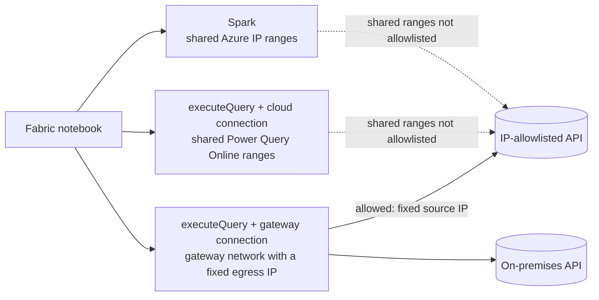

# Power Query in Fabric notebooks with notebookutils

The [November 2026 Fabric update](https://community.fabric.microsoft.com/blog/fbc_fabricupdatesblogs/fabric-november-2026-feature-summary/5414311#community-5414311-mcetoc_1k78v7lte_4) added **Power Query in Fabric notebooks (preview)**. The `notebookutils.powerquery` module runs a Power Query M query from a notebook, through an existing Fabric connection, and returns the result as a PySpark DataFrame.

The useful part is reusing Power Query connectors and **on-premises data gateway connections** from PySpark, without making Spark itself connect to the source.

> **Not designed for enterprise-scale ingestion.** This notebook-and-gateway pattern is for targeted API reads and notebook enrichment, not bulk data ingestion. For enterprise-grade data volumes, follow current Fabric ingestion best practices: use [Data Pipeline Copy activity](https://learn.microsoft.com/en-us/fabric/data-factory/copy-data-activity), [Mirroring](https://learn.microsoft.com/en-us/fabric/database/mirrored-database/overview) for supported sources, or another ingestion service appropriate to the workload.

## 1. How it works

There is a single method:

```python
notebookutils.powerquery.executeQuery(query_name, script, connections=None)
```

| Parameter | What it is |
|---|---|
| `query_name` | The query name. A string returns one DataFrame; a list returns a `QueryResults` container. |
| `script` | An M expression, or a full M document that starts with `section`. |
| `connections` | Fabric connection names or IDs, as a string or a list. Leave it out if the query needs no data source. |

A query that builds its own data needs no connection:

```python
script = """
let
    Source = #table(
        type table [Product = text, Quantity = Int64.Type],
        {{"Bike", 2}, {"Helmet", 5}}
    )
in
    Source
"""

df = notebookutils.powerquery.executeQuery("Products", script)
display(df)
```

To read from a real source, write the M as you would in Power Query, and pass the connection that holds the credentials:

```python
script = """
let
    Source = Sql.Database("<server>", "<database>"),
    Products = Source{[Schema = "<schema>", Item = "<table>"]}[Data]
in
    Products
"""

df = notebookutils.powerquery.executeQuery(
    "Products",
    script,
    connections=["<fabric-connection-id>"]
)
display(df)
```

Some points to keep in mind:

- The M script still names the source (server, database, URL), and those details must match the connection you pass.
- Use the connection ID if two connections share a name.
- If you pass a list of connections, every query in the document can use any of them. They aren't matched to queries by position.
- Gateway connections are passed exactly the same way. Power Query evaluates the query through the gateway; the notebook and returned DataFrame remain in Fabric.

To return several queries in one call, send a full `section` document and a list of names:

```python
script = """
section Section1;
shared Products = #table(
    type table [Product = text, Quantity = Int64.Type],
    {{"Bike", 2}, {"Helmet", 5}}
);
shared SelectedProducts = Table.SelectRows(Products, each [Quantity] > 2);
"""

results = notebookutils.powerquery.executeQuery(["Products", "SelectedProducts"], script)
display(results["Products"])
display(results["SelectedProducts"])
```

`QueryResults` also offers `successes`, `failures`, `get()`, `is_all_success()` and `raise_if_failed()`. Run `notebookutils.powerquery.help("executeQuery")` for the details.

## 2. Which connections can a notebook use?

Start with a Fabric connection you have permission to use. For **cloud connections**, check these requirements:

1. **It allows code-first access.** When you create the connection, select **Allow Code-First Artifacts like Notebooks to access this connection (Preview)**. You can't change this setting later. Connections created from the notebook's **Connections** pane have it selected by default.
2. **Its connection type and credential type are allowed in notebooks.** The `OAuth2` credential type isn't supported.
3. **Your tenant allows it.** A tenant setting controls Fabric connections in notebooks. It is on by default.

To check cloud connector support, use the [List Supported Connection Types](https://learn.microsoft.com/en-us/rest/api/fabric/core/connections/list-supported-connection-types) API. Look for **`supportedCredentialTypesForUsageInUserControlledCode`**, not just `supportedCredentialTypes`. A non-empty list identifies credential types allowed in code-first items such as notebooks; your connection must use one of those types.

With the Azure CLI signed in to your Fabric tenant:

```bash
az rest --method get \
  --url "https://api.fabric.microsoft.com/v1/connections/supportedConnectionTypes" \
  --resource "https://api.fabric.microsoft.com" \
  --query "{connections: value[?supportedCredentialTypesForUsageInUserControlledCode].{connectionType: type, credentials: supportedCredentialTypesForUsageInUserControlledCode}, continuationUri: continuationUri}" \
  -o json
```

The call needs the `Connection.Read.All` or `Connection.ReadWrite.All` scope. If `continuationUri` is returned, repeat the call using that URL until it is empty.

This lists **connection types**, not your saved connections. Find your own connections and IDs in **Manage connections and gateways**, and check your access permissions. For notebook-bound cloud connections, the **Connections** pane also provides **Connect**, **Copy ID**, and **Check status**.

For a **gateway**, add `?gatewayId=<gateway-id>` to the API URL to inspect its supported types; you need permission to that gateway. The cloud list below is not a gateway compatibility list. Gateway-backed Power Query access requires a connection configured for the supported source on that gateway.

On 2026-11-27, the call returned 11 cloud connection types:

| Connection type | Credential types allowed in notebooks |
|---|---|
| SQL | Basic, ServicePrincipal, WorkspaceIdentity |
| AnalysisServices | Basic, WorkspaceIdentity |
| SharePoint | Anonymous, ServicePrincipal, WorkspaceIdentity |
| Web | Anonymous, Basic, ServicePrincipal, WorkspaceIdentity |
| OData | Anonymous, Basic, Key |
| MySql | Basic |
| Oracle | Basic |
| PostgreSQL | Basic |
| AzureTables | Key, WorkspaceIdentity |
| AzureBlobs | Anonymous, Key, SharedAccessSignature, ServicePrincipal, WorkspaceIdentity |
| AzureDataLakeStorage | Key, SharedAccessSignature, ServicePrincipal, WorkspaceIdentity |

The feature is in preview, so this list may change. Run the call again rather than relying on the table.

## 3. Use case: calling an on-premises API

If your Spark environment has no network route to an internal API, an [on-premises data gateway](https://learn.microsoft.com/en-us/data-integration/gateway/service-gateway-install) provides a route through a machine on your network. With `executeQuery`, Power Query uses the gateway to call the API and returns the result as a DataFrame.

The setup:

1. Install a standard-mode gateway on a machine that can resolve the API's hostname, reach it, and trust its HTTPS certificate.
2. In Fabric, create a **Web** connection on that gateway using the API's base URL, for example `https://api.internal.example/api`. Use **Anonymous** for these examples; in the authenticated example, the API's token travels in a request header instead.
3. Pass that connection's name or ID to `executeQuery`.

These examples expect a JSON array of order objects with `OrderId`, `Region`, and `Quantity` fields. A GET request:

```python
df = notebookutils.powerquery.executeQuery("Orders", """
Table.FromRecords(
    Json.Document(Web.Contents("https://api.internal.example/api", [RelativePath = "orders"])),
    type table [OrderId = Int64.Type, Region = text, Quantity = Int64.Type])
""", connections="<gateway-web-connection>")
display(df)
```

A **read-only search** can also use POST with a JSON body and a bearer token kept in Azure Key Vault. The notebook identity needs permission to read the secret. [`Web.Contents`](https://learn.microsoft.com/en-us/powerquery-m/web-contents) requires Anonymous connection authentication for POST; the API still validates the bearer token:

```python
token = notebookutils.credentials.getSecret("https://<vault>.vault.azure.net/", "<api-token>")
df = notebookutils.powerquery.executeQuery("Search", f"""
Table.FromRecords(
    Json.Document(Web.Contents("https://api.internal.example/api", [
        RelativePath = "search",
        Headers = [#"Content-Type" = "application/json", Authorization = "Bearer {token}"],
        Content = Json.FromValue([region = "South"])])),
    type table [OrderId = Int64.Type, Region = text, Quantity = Int64.Type])
""", connections="<gateway-web-connection>")
display(df)
```

- **The URL in `Web.Contents` must match the connection URL.** Keep the base URL identical, and put the rest of the path in `RelativePath` and any parameters in `Query`. That way Power Query matches the request to your connection.
- **The token ends up inside the M text.** Read it from Key Vault as shown, and never print or log the script.
- **Keep the API operation read-only.** A search over POST is not write-back support; don't use this pattern to create, update, or delete source data.

## 4. Use case: calling an IP-allowlisted web API

Many partner and SaaS APIs only accept calls from an allowlist of IP addresses. With the default public network paths, you don't get a dedicated fixed outbound IP:

- **Spark** (for example `requests` in a notebook) sends traffic from shared Azure IP ranges.
- **A cloud connection** in `executeQuery` sends traffic from the shared Power Query Online ranges.

Neither range is specific to your tenant, so allowlisting it would let in far more than your workload.

With a gateway Web connection, the request leaves through the **gateway's network**. The API sees that network's public egress IP, which may belong to a NAT gateway, firewall, or proxy rather than the machine itself. The section 3 pattern works for internet APIs too: set both the Web connection and `Web.Contents` base URL to the external API, then allowlist that fixed egress IP. Keep API authentication in place.



For production:

- **Give the gateway a static egress IP.** For example, an Azure VM behind a NAT gateway or with a static public IP, or a server that goes out through your corporate firewall's fixed IP.
- **Cover every gateway in a cluster.** Make sure all members leave through the same IP, or allowlist each of them.
- **Keep the gateway available.** Every notebook that uses the connection depends on it.

## 5. Monitoring the cost

When a query runs on a **cloud connection**, the Power Query work runs outside your Spark session. Spark metrics (Monitoring hub, Spark UI, resource usage) don't show it.

The [Fabric Capacity Metrics app](https://learn.microsoft.com/en-us/fabric/enterprise/metrics-app-compute-page) does show it. These executions appear as **Billable** operations called **`Dataflows Gen2 Run Query API`**, charged to your capacity. They are attributed to the **notebook** that ran the query, not to the connection.

To find it:

1. Open the Capacity Metrics app and select your capacity.
2. On the **Compute** page, find your notebook. Or open the [Item history](https://learn.microsoft.com/en-us/fabric/enterprise/metrics-app-item-history-page) page, filter by your workspace, and select the operation **Dataflows Gen2 Run Query API**.
3. Read the **CU (s)** for each operation. Use an operation's total CU (s), not the smoothed value for a single timepoint.

The notebook's Spark compute is a separate entry. It appears as the notebook's run operations, or on the **Autoscale compute for Spark** page if your capacity uses [autoscale billing for Spark](https://learn.microsoft.com/en-us/fabric/data-engineering/billing-capacity-management-for-spark). A notebook that uses `executeQuery` costs the Spark entry **plus** the `Dataflows Gen2 Run Query API` entries.

> The operation name above is what the Capacity Metrics app showed during the preview. It isn't in the public Fabric operations list yet, so it may change.

## 6. Limitations

These limits come from the documentation for the preview:

- **Preview.** The behavior and the list of supported connections may change.
- **Read operations only.** Write-back to the source isn't supported.
- **Timeouts.** A query can run for up to 230 seconds, or 180 seconds through a gateway.
- **Size limits.**
  - Query names: up to 80 characters.
  - M document: up to 512 KiB in UTF-8, including the wrapper that is added around a single expression.
  - Connections: up to 100 per call.
- **Multiple queries** need a full M document that starts with `section` and defines each query as `shared`.
- **Connections.**
  - The `OAuth2` credential type isn't supported for Fabric connections in notebooks.
  - For cloud connections, the code-first checkbox can only be set when the connection is created, and the tenant setting must stay enabled.
  - Gateway-backed access needs a connection configured for a supported source.

## Further reading

- [NotebookUtils for Power Query (preview)](https://learn.microsoft.com/en-us/fabric/data-engineering/notebookutils/notebookutils-power-query)
- [Fabric Connection in notebooks](https://learn.microsoft.com/en-us/fabric/data-engineering/fabric-connection-with-notebook)
- [List Supported Connection Types API](https://learn.microsoft.com/en-us/rest/api/fabric/core/connections/list-supported-connection-types)
- [Install an on-premises data gateway](https://learn.microsoft.com/en-us/data-integration/gateway/service-gateway-install)
- [Capacity Metrics app: Item history page](https://learn.microsoft.com/en-us/fabric/enterprise/metrics-app-item-history-page)
- [Billing and utilization for Spark](https://learn.microsoft.com/en-us/fabric/data-engineering/billing-capacity-management-for-spark)
- [Fabric November 2026 feature summary](https://community.fabric.microsoft.com/blog/fbc_fabricupdatesblogs/fabric-november-2026-feature-summary/5414311#community-5414311-mcetoc_1k78v7lte_4)
